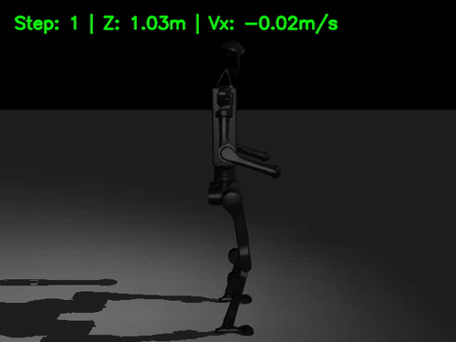
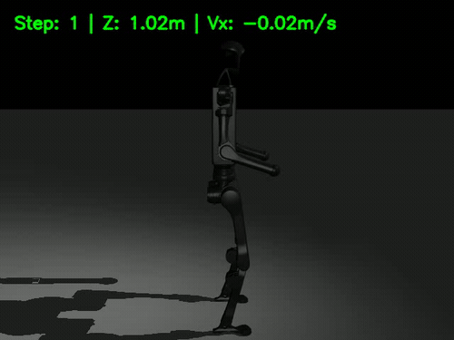
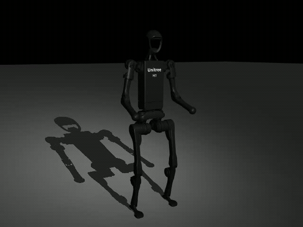

# Humanoid-RL: Unitree H1 Bipedal Locomotion with PPO

<div align="center">

[](https://www.python.org/)
[](https://pytorch.org/)
[](https://mujoco.org/)
[-orange.svg)](https://www.unitree.com/h1)
[](LICENSE)

**Nền tảng Reinforcement Learning hiệu năng cao cho robot hình người Unitree H1 (19 bậc tự do) sử dụng thuật toán Proximal Policy Optimization (PPO) trên nền tảng mô phỏng vật lý MuJoCo.**

[Tổng quan](#tổng-quan) • [Điểm nổi bật](#điểm-nổi-bật) • [Buồng lái điều khiển](#buồng-lái-teleoperation-cockpit) • [Cài đặt & Chạy nhanh](#cài-đặt--hướng-dẫn-chạy) • [Huấn luyện Curriculum](#huấn-luyện-curriculum)

</div>

---

## 🌟 Điểm nổi bật & Trực quan hóa

### 1. Sải bước đi bộ ổn định (Bipedal Locomotion @ 1.0 m/s)
Robot duy trì sải chân đều đặn, nhấc chân cách mặt sàn $0.08\text{ m}$ (foot clearance), đánh tay tự nhiên và giữ thăng bằng thân thẳng đứng tuyệt đối suốt 1,000 bước mô phỏng.

<div align="center">
  
</div>

<br/>

### 2. Đứng cân bằng CoM & Lái hướng đi thời gian thực (Interactive Steering)

<div align="center">
<table>
  <tr>
    <td align="center" width="50%">
      <b>Thăng bằng CoM đứng yên (Zero Drift)</b><br/>
      <br/>
      <sub>Trọng tâm (CoM) được giữ chính xác trên đa giác đỡ giữa 2 bàn chân với kiểm soát góc cổ chân 40 Nm.</sub>
    </td>
    <td align="center" width="50%">
      <b>Lái hướng đi & Đánh cua (Steering Teleop)</b><br/>
      <br/>
      <sub>Điều phối xoay góc hông (hip yaw) và thân (torso) để rẽ trái / rẽ phải mượt mà trong khi đang bước đi.</sub>
    </td>
  </tr>
</table>
</div>

---

## 🎮 Buồng lái Teleoperation Cockpit (Web-based 50 Hz)

Dự án tích hợp sẵn giao diện **Cyberpunk Teleoperation Cockpit** chạy trên nền Web, cho phép bạn lái robot từ xa bằng bàn phím qua mạng nội bộ hoặc SSH mà không cần màn hình desktop X11:

<div align="center">
  
</div>

### Tính năng điều khiển:
* **Phím di chuyển**:
  * <kbd>W</kbd>: Robot tiến bước tới trước.
  * <kbd>A</kbd> / <kbd>D</kbd>: Đánh cua rẽ hướng sang trái / sang phải.
  * <kbd>S</kbd>: Giảm tốc độ sải bước.
  * <kbd>Space</kbd>: Kích hoạt chế độ phanh và đứng thăng bằng yên tuyệt đối tại chỗ.
* **Góc nhìn camera đa hướng**:
  * **Chase Cam**: Tự động bám sau lưng robot khi chuyển hướng.
  * **Orbit Cam**: Góc nhìn 3/4 quan sát nhấc chân.
  * **Front / Top-down Cam**: Góc nhìn trực diện và từ trên xuống.
* **HUD Telemetry trực quan**:
  * Đồng hồ vận tốc di chuyển thực tế ($V_x$).
  * Thước đo độ cao thân robot (Torso Height nominal: $1.02\text{ m}$).
  * La bàn phương vị (Heading Compass $0^\circ \to 360^\circ$).
  * Đèn cảm biến tiếp xúc mặt đất 2 bàn chân (Grounded vs Swing).

---

## 🏗️ Kiến trúc & Tối ưu thuật toán

| Thành phần | Đặc tả kỹ thuật |
|---|---|
| **Robot** | Unitree H1 Humanoid (19 actuated joints, 25 velocity DOF) từ MuJoCo Menagerie |
| **Control** | PD Position Control ($K_p, K_d$ tuned per joint, ankle authority: $40\text{ Nm}$) |
| **Algorithm** | Proximal Policy Optimization (PPO) chuẩn CleanRL (không tanh-squash bug) |
| **Advantage** | Generalized Advantage Estimation (GAE $\lambda=0.95, \gamma=0.99$) với **Truncation Bootstrapping** |
| **Reward Normalization** | Chuẩn hóa phần thưởng trực tuyến theo phương sai song song Chan et al. |
| **Observation** | 252 chiều (qpos + qvel + body heights + contacts + CoM + orientation + gait phase $\times 3$ history) |

---

## 🚀 Cài đặt & Hướng dẫn chạy

### 1. Cài đặt môi trường
```bash
git clone https://github.com/hiwe0305/humanoid-rl.git
cd humanoid-rl

# Tạo và kích hoạt virtualenv
python3 -m venv venv
source venv/bin/activate

# Cài đặt thư viện phụ thuộc
pip install -r requirements.txt
```

### 2. Trải nghiệm Buồng lái Teleoperation Cockpit (Lái bằng bàn phím)
```bash
PYTHONPATH=. venv/bin/python scripts/play_teleop.py --port 8080
```
> Mở trình duyệt tại **`http://localhost:8080`**, dùng phím **W / A / S / D / Space** để lái robot.

### 3. Xuất video MP4 chất lượng cao
```bash
PYTHONPATH=. MUJOCO_GL=egl venv/bin/python scripts/play_checkpoint.py \
    --checkpoint runs/h1_phase2_walk/checkpoints/checkpoint_final.pt \
    --record-video h1_walk_demo.mp4 \
    --steps 500
```

### 4. Benchmark kiểm tra chỉ số (Headless)
```bash
PYTHONPATH=. venv/bin/python scripts/play_checkpoint.py \
    --checkpoint runs/h1_phase2_walk/checkpoints/checkpoint_final.pt \
    --steps 1000
```

---

## 📈 Quy trình Huấn luyện Curriculum (3 Phases)

Hệ thống được huấn luyện theo lộ trình tăng dần độ khó (Curriculum Learning) để đảm bảo robot làm chủ sự thăng bằng trước khi học đi:

```
┌─────────────────────────────────┐
│ Phase 0: STAND (Đứng thăng bằng)│ ──► Học thăng bằng CoM trên 2 bàn chân (Reward: 14,500+)
└────────────────┬────────────────┘
                 ▼ (Zero-injection transfer: obs 246 -> 252)
┌─────────────────────────────────┐
│ Phase 1: SLOW WALK (0.3 m/s)    │ ──► Học nhịp CPG xen kẽ và nhấc chân bước ngắn
└────────────────┬────────────────┘
                 ▼
┌─────────────────────────────────┐
│ Phase 2: FULL WALK (1.0 m/s)    │ ──► Sải bước đi nhanh hoàn chỉnh (Sống 100% episode)
└─────────────────────────────────┘
```

Chạy toàn bộ lộ trình:
```bash
PYTHONPATH=. MUJOCO_GL=egl python scripts/train_walk.py --n-envs 16
```

---

## 📂 Cấu trúc thư mục

```
humanoid-rl/
├── humanoid_rl/
│   ├── algorithms/ppo/       # PPO Trainer, Rollout Buffer, Actor-Critic
│   ├── envs/mujoco/          # Môi trường MuJoCo H1, PD Controller, Terrains
│   ├── rewards/              # Locomotion, Stability, Gait phase CPG rewards
│   └── robots/               # Cấu hình robot Unitree H1
├── scripts/
│   ├── play_teleop.py        # 🎮 Buồng lái Cyberpunk Teleoperation Cockpit
│   ├── play_checkpoint.py    # 🎥 Script inference, video recorder, WebGL viewer
│   ├── train_walk.py         # 🏋️ Huấn luyện Curriculum Walk (Phase 0, 1, 2)
│   └── train_balance.py      # 🧘 Huấn luyện Stand Balance
├── docs/assets/              # 🎬 GIF demo & hình ảnh minh họa
└── configs/                  # File cấu hình tham số Hydra / PPO
```

---

## 📄 License
Phát hành theo giấy phép [MIT License](LICENSE).
